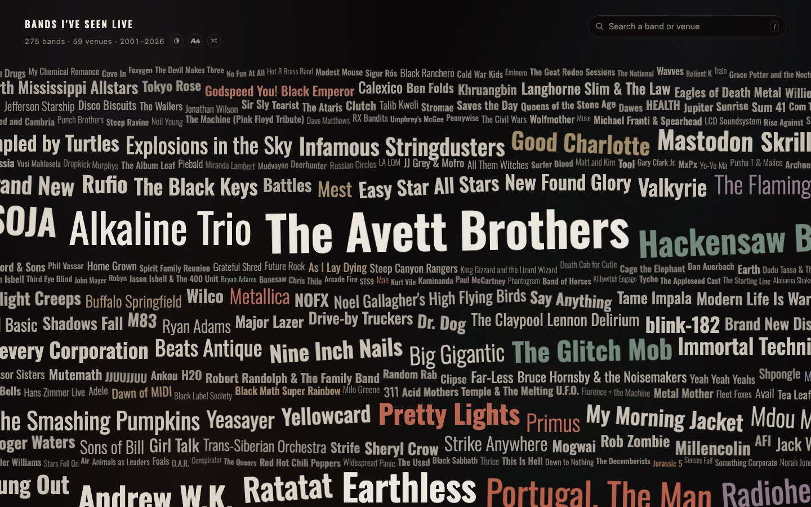
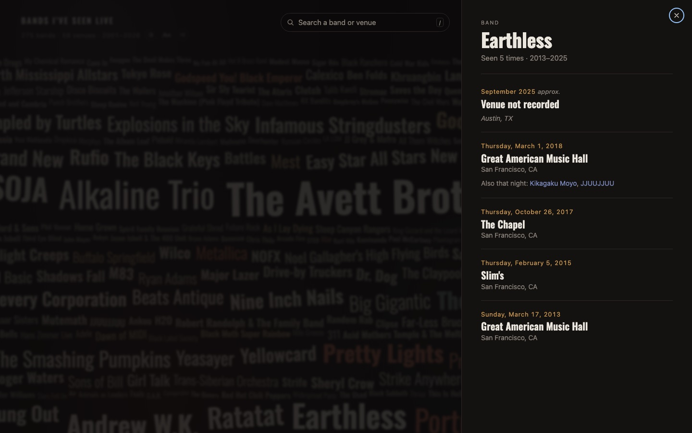
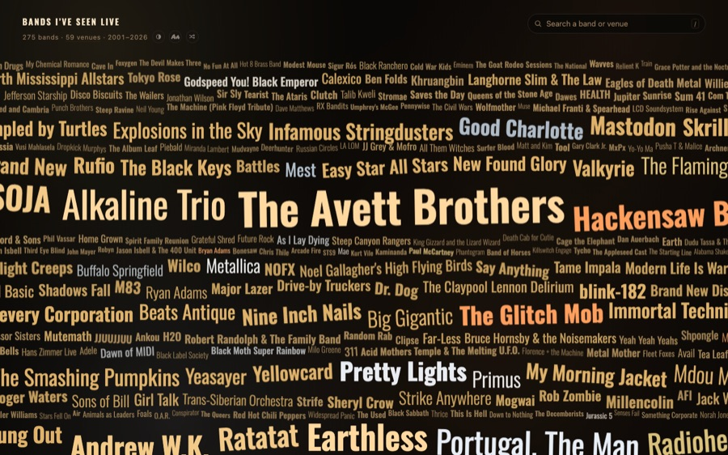
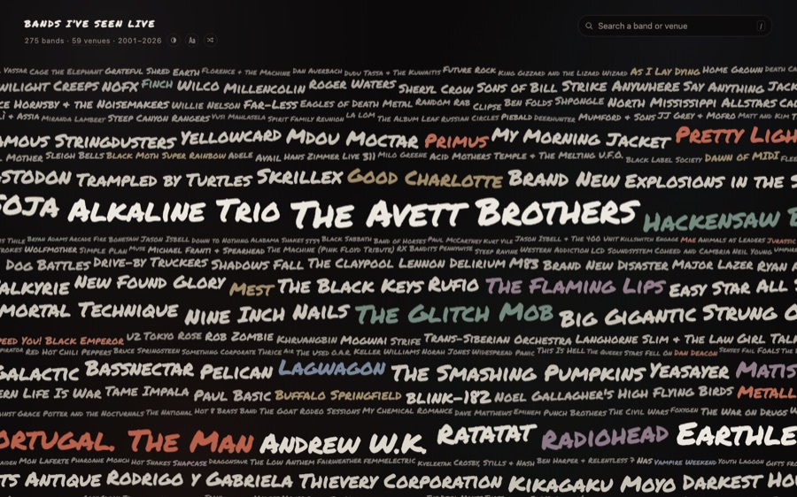

# Band Cloud

Every band I've seen live, as a word cloud. Click a name for when and where;
search to jump straight to a band, venue, or festival.

Built for and running at **[ryanarnaudin.com](https://ryanarnaudin.com)**, where
it lives in a subdirectory.



Coverage is a property of the layout algorithm rather than of tuning: rows are
packed past the container edge and scaled back to fit, so whitespace has nowhere
to appear and names bleed off the sides by design. Every load composes a new
arrangement.

Clicking a name opens its history — every date and venue, festivals, tour notes,
and who else was on the bill that night:



Two themes and two typefaces, each toggled from the masthead:

| Marquee theme | Marker typeface |
|---|---|
|  |  |

## Stack

None. Static HTML, CSS, and ES modules — no framework, no dependencies, no
external requests at runtime. Two self-hosted webfonts (60KB total). The only
Node in the project is the data tooling, and it has no packages either.

Everything uses relative paths, so the built folder can be dropped at any subpath
of any static host (`/shows/`, `/concerts/`, wherever) with no configuration.
Routing is hash-based for the same reason — no rewrite rules required.

```
index.html
assets/          runtime — styles, ES modules, fonts, generated data.json
data/            source CSV + corrections (the real pair is gitignored)
tools/           build.mjs · dist.mjs · audit.js
```

## Running it

```bash
node tools/build.mjs                 # data/*.csv -> assets/data.json
python3 -m http.server 8146          # then open localhost:8146
```

A fresh clone works immediately. The real show history is private, so the build
falls back to the committed `data/sample.csv` and renders a working wall of
invented bands.

Serve it over HTTP. Opening `index.html` as a `file://` URL gives a blank wall,
because the page fetches `assets/data.json` and uses ES modules, both of which
browsers block on `file://`.

To publish: `node tools/dist.mjs` assembles `dist/` — `index.html` and `assets/`
only, nothing else — and that folder is the deployable site.

## The data

`data/source.csv` is the source of truth. `assets/data.json` is generated from
it; never hand-edit that. [UPDATING.md](UPDATING.md) has the full workflow.

### CSV format

Four columns, and **one row per band, not per show**. Two bands on the same
night at the same venue are two rows sharing a date and venue; the build groups
them back into one show, and each then lists the other under "Also that night."

| Column | Notes |
|---|---|
| `Band` | Required. A blank row is skipped. |
| `Date` | Optional, several formats — see below. |
| `Venue or Festival` | Optional. `Venue, City` and `Venue, City, ST` are parsed. |
| `Notes` | Optional. Tour name, festival, URL, or free text. |

**Dates.** The parser takes what a real sheet actually contains rather than
forcing one format:

| Written | Read as |
|---|---|
| `9/24/2025` · `"December 7, 2002"` | exact day |
| `7/26-29/2012` | a run of days, for festivals |
| `9/30-10/2/2016` | a run crossing a month |
| `11/2023` · `November 2023` | month only — labeled *approx.* in the UI |
| `2003` | year only — labeled *approx.* |
| *(blank)* | "Date not recorded" |

Anything coarser than a day is marked approximate, so a vague memory never reads
as a precise claim. A date containing a comma must be quoted in the CSV;
spreadsheet exports do that automatically.

Undated rows are **never merged into a shared night**, even at the same venue —
that would be inventing a fact. Give them dates and they combine on their own.

**Venues.** Put the city in the cell and it is read directly, so a new venue in
a new town needs no configuration:

| Written | Result |
|---|---|
| `Radio East, Austin` | venue, city, state inferred |
| `Boar's Nest Cafe, Harrisonburg, VA` | venue, city, state |
| `The Fillmore` | venue with no city — flagged in `REVIEW.md` |
| `Austin, TX` | city only, no venue named |

A two-letter code as the *second* part means "city, state with no venue," which
is why `Austin, TX` doesn't create a venue called Austin.

**Notes** are sorted by what they contain: a URL becomes a link, a value listed
in `festivalNotes` becomes a festival badge, and anything else is shown as a
tour or billing note. When every act on a bill carries the same note, it is
printed once for the show instead of repeated after each name.

### Corrections

Anything the sheet can't express lives in `data/overrides.json` — artist and
venue aliases, city/state lookups, festival mappings, date fixes. Keeping it
separate from the CSV means re-exporting the sheet never discards cleanup work.

The build asserts its own output — no duplicate IDs, no orphan references, no
empty lineups, artist and show appearance counts in agreement — and exits
non-zero on regression without overwriting anything. Whatever it can't resolve
confidently goes to `REVIEW.md` as a checklist rather than being guessed at.

## Layout

`assets/cloud.js` is the wall engine. Coverage is a property of the algorithm
rather than of tuning:

- every row is packed to a target 7% wider than the container, then scaled and
  gap-justified to land exactly on it, so no row can end short;
- a binary search sets one global type scale from the larger of two bounds — the
  smallest scale whose rows stack past the fold, and a legibility floor. On a
  wide screen the first wins and the whole wall lands in one screen; on a narrow
  one the floor wins and the wall grows past the fold and scrolls.

The organic feel is layered on top of that guarantee: rows are size-homogeneous
but shuffled in order, sizes gradate continuously rather than in discrete steps,
words float in whatever vertical slack their row has, and wide words tilt by
however much that slack can absorb.

**Sizing** is driven by how often a band was seen. Repeat appearances set a floor
tier and are always large; the bands seen once — the large majority of any such
list — are spread across the smaller tiers by deterministic per-name variation.
Their sizes carry no information, so the variation costs nothing and buys visual
rhythm.

### Why the leftover row is pinned to the bottom

`packRows` emits a final remainder row that is short by construction. It can be
stretched but not reliably filled, so it is held out of the row shuffle and
always placed last. Anywhere else it reads as a hole — a fraction of the ink
density of a healthy row, with gutters an order of magnitude wider. At the
bottom it is either clipped entirely (the one-screen case) or reads as the
ragged last line of a justified column, which is ordinary typesetting.

This is only visible once the layout is randomized; with a fixed seed that row
lands wherever it happens to land. It's the main argument for auditing across
seeds rather than eyeballing one.

### Known limits

Word rotation is capped at a few degrees. Full 90° verticals are incompatible
with justified-row packing — a rotated name needs vertical room equal to its own
width, which either breaks the coverage guarantee or blows out row heights.
Supporting them would mean treating verticals as multi-row column blocks placed
before the rows are packed.

## Color

Two themes, toggled with the half-circle chip or `C`, remembered in
`localStorage`.

- **Ink & Ash** (default) — near-black, warm grays, color used sparingly.
- **Marquee** — tungsten bulbs on a theater front; one hue family, with all the
  variation in temperature and value.

The structural idea in both is a **tonal ramp**: tier drives *lightness*, not
just size (`--w0`…`--w5`). With a single foreground color, size does all the work
alone and a dense wall reads as a sheet of white. Letting value carry the
hierarchy pushes one-off names toward the ground and brings repeats forward, so
scale and lightness reinforce each other.

Accents are mixed toward *that tier's own ramp value*, never toward the
background. Color then reads as a hue shift at roughly constant lightness rather
than as a brightness drop, so it never fights the hierarchy — and the result's
contrast is bounded below by two endpoints that both clear AA, so an accent
can't quietly sink out of legibility.

Every word in both themes clears **4.5:1** against its ground. That constrains
the design: the ramp wants to go darker at the bottom, but the smallest tiers
hold most of the words, so a prettier floor would put the majority of the page
under AA.

## Typefaces

Two self-hosted faces, toggled with the `Aa` chip or `T`, remembered in
`localStorage`. The button is always set in the face you would switch *to*, so it
previews its own result.

- **Oswald** (default) — variable 300–700, condensed grotesque. 28KB.
- **Permanent Marker** — marker on a wall. 29KB.

Each face carries its own typographic budget in `FACES` (`assets/app.js`) rather
than sharing global constants, because they aren't interchangeable. The marker
hand is a single weight, so there is no weight range to build tonal texture
from, and it carries more apparent size per em, so it needs a different
legibility floor to sit at the same optical weight. Switching re-derives the
words from the *same* seed, so the composition survives and only the type
changes.

Both are the Google Fonts `latin` subset (U+0000–00FF). Licenses in
[`assets/fonts/LICENSES.md`](assets/fonts/LICENSES.md).

## Randomness

Every load composes the wall afresh — sizes, weights, colors, tilt, row
composition, and position all reshuffle. Bands with repeat appearances stay
pinned to the large tiers by their count, because that is the one thing on the
page carrying information. The rest are free to trade places, so the long tail
gets its turn at being featured.

Shuffle in place with the `↻` chip or `R`.

The seed is per *session*, not per layout: `render()` re-runs on every resize, so
a resize reflows the same composition rather than scrambling it.

To keep a layout, read `bandCloud.seed` in the console and reload with
`?seed=<number>`. That parameter is read but never written — auto-writing it on
shuffle would make the next reload reproduce the same wall, which is the thing
randomness exists to avoid.

`?theme=` and `?face=` work the same way: they override the saved preference for
one visit without changing what the browser remembers. Useful for linking a
particular look, and for scripted captures — the screenshots above were taken
headlessly with a pinned seed, so they can be reproduced exactly.

## Auditing the layout

`tools/audit.js`, pasted into the browser console on the running page:

```
__audit()          one arrangement, current viewport
__sweep(50)        reshuffle and audit 50 times
__report()         worst-case summary
__sweepFaces(25)   the same, across every typeface
__reportBy('vp')   group results by viewport
```

It measures pairwise glyph-box overlap (via a y-sweep, since all-pairs is tens
of thousands of comparisons per run) and horizontal coverage band by band.
Report the **worst** case across a sweep, not the average — a random layout
means checking one arrangement proves nothing about the next.

What to look for: overlapping pairs should be at or near zero, and the few that
survive are axis-aligned bounding boxes on tilted words, where the boxes
intersect but the glyphs don't. Coverage and largest-contiguous-gap are the
whitespace signals; a lone sparse band is just leading between rows, while a run
of them is a hole.

The auditor has caught bugs that passed visual review — tilted words colliding
with the row above, and the leftover row landing mid-wall. Both looked fine in a
screenshot.

Layout self-scoring (`clampedRows`, `worstFit`, `lastRowGrowth`) is always
computed but surfaced only on request: add `?debug` to the URL, or set
`bandCloud.debug = true`.

## Motion

Two rules the layout depends on:

**Hover changes no geometry.** A scale on hover jitters badly on a dense wall.
With `transform-origin` at `0 0` the box grows right and down, moving its own
hit-edge out from under the cursor, which drops hover, which shrinks it back,
which re-enters hover; the grown box also steals hover from the word beside it.
The lift is a value lift instead — the hovered word climbs to the top of the
tonal ramp.

**Parallax depth is per row, not per word.** Depth by word means neighbors in the
same row slide at different rates, and that relative movement is larger than the
few pixels of gap between small adjacent words, so they collide as the pointer
moves. Rows now slide as rigid units with a uniform vertical component, so
nothing moves relative to anything it could touch, and overlap counts are
identical whether the pointer is centered or at double amplitude.

The second one is an auditing lesson as much as a layout one: a sweep run
without moving the pointer leaves the parallax offset at zero, which hides the
problem from both the audit and any screenshot.

## Background

`assets/haze.js` paints a static, low-contrast wash. It is written as the seam
for a planned live-lightshow / liquid-projection visualization, with the
legibility budget already pinned down: a master `--haze-intensity` dial in CSS, a
per-source alpha ceiling, and motion gated on `prefers-reduced-motion` and tab
visibility. See the comment at the top of the file.

## License

Code is MIT — see [LICENSE](LICENSE). Two exceptions, both noted there:

- The bundled fonts keep their own licenses (SIL OFL 1.1 and Apache 2.0), with
  full texts in [`assets/fonts/`](assets/fonts/LICENSES.md).
- The real concert history is personal and is not in this repository.
  `data/sample.csv` is invented placeholder data.
